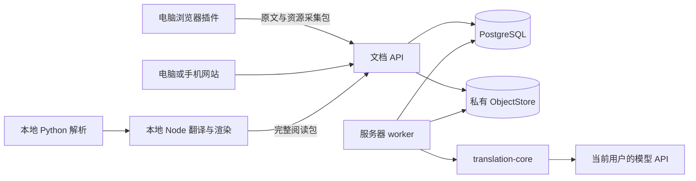

# PageLingo 个人学习站 V1 设计

设计日期：2026-10-26。用户批准日期：2026-10-27。状态：已批准；S1 已交付并合入 main，S2 进入实现计划。

PageLingo 将网页收藏、PDF 保存、翻译和阅读放入每个用户自己的资料库。主要使用方式是电脑浏览器收藏，在电脑或手机访问站点阅读；PDF 在本机完成解析、翻译和阅读包生成，再上传服务器长期保存。服务器保存原件、结构化内容、译文和资源，重复阅读使用已有产物。

本设计作为个人学习站 V1 的范围依据。现有 [网页插件规格](../../web-spec.md)、[PDF 规格](../../pdf-spec.md)和 [PDF 本机处理设计](../../pdf-processing.md)继续提供模块细节；发生冲突时，账号、采集入口、首版范围与阅读模式以本设计为准。原 [个人双语技术文档站设计](../../personal-bilingual-document-site-design.md)保留为早期参考。

## 1. 已确认的产品决定

| 编号 | 决定 | 结果 |
| --- | --- | --- |
| R01 | 以个人收藏和学习为中心 | 保存资料、阅读和回顾构成主要流程 |
| R02 | 各用户保存自己的数据，首版不共享 | 文档、资源、译文、集合、标签、任务、阅读位置和 API 配置按用户授权 |
| R03 | 首版有管理员账号和简单用户管理界面 | 部署时初始化管理员；管理员手工创建、重置密码和停用普通账号 |
| R04 | 账号由管理员开通 | 网站提供登录，用户可修改自己的密码 |
| R05 | 每个用户填写自己的模型 API | 配置 Base URL、API Key、模型及连接测试；服务端保存密钥 |
| R06 | 电脑端负责收藏和处理 | 插件为主要采集入口，网站提供链接、PDF 和阅读包导入 |
| R07 | 手机端优先保证访问和阅读效果 | 窄屏使用资料列表、搜索和正文阅读，PDF 原文与译文切换显示 |
| R08 | 中文内容可以仅作收藏 | 保存原文和资源后即可阅读，不因没有译文而显示失败 |
| R09 | 网页翻译延续插件体验 | 原文、仅译文、段落双语模式；已有译文持久保存 |
| R10 | PDF 左侧原件、右侧译文 HTML | 电脑支持左右对照、原文单看、译文单看，按来源定位原页 |
| R11 | 本地处理 PDF 后上传完整材料 | 本机和阅读服务器可分开；原件、解析、译文、资源与阅读产物一起保存 |
| R12 | 常读来源为 X、技术博客、GitHub、arXiv、知乎、微信公众号 | 资料类型与采集来源分开建模；GitHub 仓库是独立收藏类型 |
| R13 | 清爽、柔和、干净，并有克制的科技感 | 采用已确认的灰色界面、暖灰阅读区、少量青绿强调及明暗主题 |

以下章节中标为“实现建议”的内容由实现方提出，已随本设计获批；保留其提出来源，不将其追记为最初由用户提出的要求。

## 2. 现有基础与实现范围

### 2.1 可复用能力

- `apps/extension` 已实现网页翻译、X 主帖和长文正文定位、显示模式、设置、持久化任务和阅读助手。
- `packages/translation-core` 已提供纯数据文档模型、格式与不可变对象保护、个人术语、Provider、预算、重试、缓存和检查点接口。
- `packages/assistant-core` 已提供纯数据阅读上下文和对话能力，后续可用于站内阅读助手。
- `services/document-parser` 已提供 P0 评测、Docling / MinerU 适配、原件与 raw 留存、来源归一化。
- `benchmarks/pdf/tools` 已提供按页加载的原文 HTML 包、图表区域图、公式排版及原生布局补充。

### 2.2 本次需要新建的能力

`apps/web` 与 `apps/document-service` 当前只有规划 README。账号、数据库迁移、对象存储、服务器任务、插件归档、正式 Reader IR、持久化译文阅读包、导入协议和部署都需要实现。

当前 `source-layout.json` 与 P0 schema 是评测和布局补充，不能直接作为正式 Reader 公共协议。扩展的 `source-snapshot.ts` 用于正文变化判断，也不是可重放的网页归档。正式适配必须补齐资源和格式绑定。

### 2.3 V1 交付范围

1. 登录、初始管理员、手工创建用户、重置密码、停用和重新启用账号。
2. 个人 API 配置、连接测试、个人术语导入，以及后端任务使用当前用户配置。
3. 资料列表、来源与类型筛选、集合、标签、收藏备注、标题编辑、未读 / 在读 / 已读、阅读位置。
4. 链接记录、网页采集、资源快照、中文原文阅读、英文翻译及重新翻译。
5. PDF 原件上传、本地处理包导入、原 PDF 与译文 HTML 阅读、原页定位。
6. GitHub repo 的元信息与 README 快照；arXiv 论文元信息、版本和 PDF 保存。
7. 下载原件、导出完整阅读包、删除与恢复、任务状态和有界重试。
8. 标题、作者、来源 URL / 域名、集合与标签搜索；电脑与手机的基础阅读适配。
9. 服务器部署、数据库与对象备份、空环境恢复及既有插件 / SDK 回归。

### 2.4 后续范围

资料共享与公开发布、自助注册、移动 App 内直接采集、GitHub Star 同步、完整代码仓库镜像、X 时间线与全量帖子串抓取、视频归档、全库语义搜索、高亮批注、站内助手、LaTeX、自动远程 GPU 任务领取、保持原版式的中文 PDF 单独进入后续规格。

首次 PDF 交付以有文本层的技术资料为基线。扫描或结构不足的资料可以保存原件，明确显示处理限制；原件区域中的文字不能标为已经翻译。增强解析配置继续按真实样本评测，不用现有 basic 包代表高质量解析已经完成。

## 3. 建设方式与取舍

此前讨论已经确定“本机处理 PDF、服务器保存与阅读”，并选定网站、插件和现有 SDK 协作的产品形态。对应的建设方式如下：

| 方式 | 收益 | 局限与适用性 |
| --- | --- | --- |
| 主要保存链接和静态 HTML | 很快得到可浏览归档 | 多用户管理、重译、任务恢复与来源定位仍需要应用服务 |
| 全部采集、PDF 推理与翻译部署到服务器 | 处理入口集中 | 需要服务器承担推理资源和复杂网页访问条件，与本地处理方向不符 |
| 模块化文档服务与网站，加浏览器采集和本地 PDF 处理 | 复用现有 SDK、保留完整数据，处理机与阅读服务器分开 | 先定义网页归档、Reader IR 和完整阅读包的共同边界 |

**实现建议：采用第三种。** 一个 TypeScript 文档服务提供 API 与独立 worker 入口，数据库和文件存储集中管理；本地 Python parser 与 Node 翻译 / 渲染工具产出版本化阅读包。各阶段交付一个能独立验收的使用流程。

实现建议的技术基础：

| 职责 | 选择与依据 |
| --- | --- |
| 网站 | React / TypeScript / Vite，沿用仓库技术栈；采用统一 token 和共享 UI 组件 |
| UI 实现 | Tailwind CSS 与按需引入的 shadcn 基础组件，图标统一使用 Lucide；依赖版本在 Plan 中锁定 |
| 文档 API 与任务 | Node.js 24+ / TypeScript，建议 Fastify；直接调用 SDK 的公开入口 |
| 状态数据库 | PostgreSQL，沿用现有 PDF / monorepo 设计 |
| 文件与资源 | ObjectStore 接口，首版 LocalObjectStore 使用持久化磁盘目录 |
| PDF 原件展示 | PDF.js；显示与来源映射适配独立于 Python parser |
| PDF 重计算 | 本地 Python 3.12 / uv 与已有适配器；Node 工具负责共享 SDK 翻译和渲染 |
| 部署 | 单服务器反向代理、API、worker、PostgreSQL 与持久卷；运行时配置密钥 |

本地离线处理只需要文件、manifest 和检查点；不要求本地处理机再维护一套业务 PostgreSQL。S3 适配器后续复用对象存储合同，迁移时校验对象，不以切换配置代替迁移。

## 4. 收藏对象与来源适配

### 4.1 资料类型

`article`、`x-post`、`repository`、`paper`、`pdf` 是资料类型；`x`、`github`、`arxiv`、`zhihu`、`wechat`、`web`、`upload` 是来源。arXiv 论文可以同时拥有元信息、原 PDF 与后续阅读产物。GitHub repo 具有仓库身份和固定版本的 README。

同一用户多次保存同一资料时显示已有条目，可新增快照版本或来源关联；同一个 URL 的不同内容不能直接视为同一快照。跨用户不提供内容去重结果或共享文件访问。

### 4.2 适配范围

| 来源 | 首版收藏单位 | 采集策略与完整性 |
| --- | --- | --- |
| X | 当前主帖或长文 | 从用户已打开的页面采集正文、作者、时间、可获取图片与外链；回复、引用帖和线程成员分别记录边界 |
| 技术博客 | 单篇文章 | 网站可尝试公开链接抓取；插件保存当前浏览器正文、快照和资源 |
| GitHub | repo；文档子页可另存文章 | 保存稳定仓库 ID、仓库名、简介、原链接、采集时间及 README 对应 commit；默认不复制完整代码仓库 |
| arXiv | 固定版本的论文 | 保存论文 ID、版本、题目、作者、摘要及对应 PDF；未带版本链接在保存时解析并固定版本 |
| 知乎 | 单个回答或文章 | 插件采集当前回答 / 文章，保留问题上下文；不能将已加载的一个回答说成整个问题已归档 |
| 微信公众号 | 单篇文章 | 在电脑浏览器打开后采集正文和可获取图片；中文默认直接保存阅读 |

粘贴链接始终能创建链接记录。抓取成功后升级为正文和资源已保存；需要登录、遇到验证、正文未加载或资源缺失时，保留链接并给出“待补快照”或“部分资源缺失”。采集质量在每个来源的真实样本上验收，不承诺抓取所有页面。

X 中提及的博客、repo 或论文可以点选另行收藏，并保留 `discovered-from` 关系。首版实现建议只做用户明确选择的关联收藏，不递归抓取所有外链。

### 4.3 网页需要保存什么

每次采集保存原 URL、候选 canonical URL、标题、作者、来源时间、采集时间、范围和完整性提示，同时保存：

1. 原文快照：序列化原文 DOM 与可获取的 CSS、图片和公式资源，保留采集时的可见内容与外观。
2. 阅读内容：清洗后的正文结构、章节、段落、列表、代码、公式、图注与资源引用。
3. 可选译文：仅导入与上述原文和绑定相匹配的现有翻译结果。

原网页脚本、表单状态、Cookie、Authorization 和插件注入界面不属于采集包。页面里的导航链接保留为原网站链接；保存资源使用站内资产引用。网页快照供回溯，阅读视图供稳定翻译、搜索和阅读，两者都标明实际保存范围。

插件采集时克隆原文结构，保留与当前译文对应的源节点快照，避免将中英混排 DOM 再次当作原文。图片、MathML / SVG 公式、格式绑定和列表容器需要可持久化引用；网络上传不包含 HTMLElement、Node 或 Chrome 运行对象。

## 5. 用户使用流程

### 5.1 插件收藏

1. 用户在插件内配置站点地址并连接自己的站点账号；原有网页翻译可以独立使用。
2. 打开资料，点击“收藏到 PageLingo”，确认标题、范围、可选集合和标签。
3. 插件把采集清单与待上传材料写入持久化 outbox，使用稳定的幂等键上传。
4. 服务端验证并固定源版本；返回原文、资源和导入状态。
5. 中文进入原文阅读；英文在有 API 配置且启用自动翻译时创建后台任务。
6. 从站点打开资料，即使原页面关闭，也能阅读已保存原文和已有译文。

网络中断可从未完成文件继续，重复投递不重复创建文档。上传完成前显示“上传中”；仅服务器确认保存后显示“原文已保存”。缺失图片等仍列为明确警告。

### 5.2 网站粘贴链接

输入链接后先保存链接记录，再异步获取元信息、正文和资源。公开博客、GitHub 和 arXiv 可采用各自适配器。抓取失败保留记录和原因，用户可以在桌面插件补齐快照。

### 5.3 PDF 原件和本地处理

网站上传 PDF 后，原件立即进入资料库，完成文件校验后可阅读；尚无处理产物时显示“等待本地处理”。

本机工具可以从本地 PDF 开始，也可以处理从站点下载的同一原件。Python 解析 / 重建完成后，Node 侧投影为 SDK 文档，执行翻译，生成阅读视图和完整资源包。各阶段记录 source hash、版本、配置摘要和检查点。

用户将完整包上传到自己账号。服务端根据原件 hash 和显式目标文档绑定到已有条目，或创建新条目；相同包重复导入幂等。原件不同的包不能覆盖目标条目。校验失败只留下失败记录，不切换当前可读版本。

本地配置中的 API Key 留在本地。包中包含脱敏的生成配置与用量，服务器导入包不需要取得该 Key。首版通过手工运行工具和上传包完成流程；本地处理机关闭后，已导入内容照常可读。

### 5.4 翻译策略

目标语言默认中文。中文资料默认标记“无需翻译”；英语或其他可识别外语资料可自动翻译；中英混合、内容很短或判断不确定时保留原文并提供手动选择。语言判断先用确定性规则 / 本地库，不为了判断语言而调用付费模型。

自动翻译是用户可关闭的偏好。首次无 API 配置时收藏照常成功，状态为“待配置翻译”；用户保存 API 配置后，明确选择开始待处理任务，避免配置测试自动启动历史资料翻译。

重译创建新的 translation run，复用源内容与有效缓存，完成后才切换当前版本。模型、术语或 API 配置变化不自动覆盖旧译文。SDK 检查失败的单元保留原文，已完成的其他译文可读。

## 6. 页面与阅读行为

### 6.1 主要页面

| 页面 | 主要内容 |
| --- | --- |
| 登录 | 用户名、密码、明确错误；账号由管理员开通 |
| 资料库 | 继续阅读、搜索、类型与状态筛选、集合、资料条目、添加入口 |
| 资料详情 | 来源信息、快照 / 版本、翻译状态、收藏备注和下载操作 |
| 网页阅读 | 原文 / 译文 / 段落双语，目录、来源链接和原快照入口 |
| PDF 阅读 | 左侧 PDF、右侧译文 HTML，目录、模式切换、原页定位与阅读设置 |
| 模型与账户 | 当前用户的模型、API、连接测试、术语、密码、插件连接与设备撤销 |
| 用户管理 | 管理员查看账号列表、创建用户、重置密码、停用 / 启用 |

### 6.2 PDF 对照

电脑端默认显示左侧原 PDF、右侧译文 HTML；左右区域独立滚动，可调整分栏宽度。目录可折叠，支持原文单看、译文单看。

选择某个译文段落的“定位原文”时，在左侧打开对应 PDF 页。来源有可靠 bbox 时高亮该区域，只有页码时明确使用页级定位。跨页段落可具有多个来源，用户可分别查看。首版不要求按滚动百分比强制同步，也不承诺译文与原页像素对齐。

手机默认单栏译文，顶部切换原 PDF；原件可缩放与翻页。表格或代码单独横向滚动，页面本身保持适应屏宽。

原 PDF、结构化原文和译文是不同视图。中文 PDF 可以直接阅读原件或结构化原文，翻译状态为“无需翻译”。图表、算法和无法可靠恢复的公式可以保留原件区域图，正文与图注按可翻译性分别处理。

### 6.3 长文与阅读进度

章节、block ID 和来源定位共同组织文档。长书按页或有界内容窗口加载，离开窗口后释放 DOM，CSS 与字体共享；不将整本正文隐藏在折叠容器中。

进度保存文档、parse / source 版本、block ID、块内偏移及 PDF 页码，按账号持久化。跨设备恢复使用同一版本；重解析后找不到原 block 时降级到原页或章节并提示，保留旧位置用于回溯。

### 6.4 管理操作

一个文档首版允许放入一个集合、添加多个标签和一段收藏备注。支持修改标题、移动集合、筛选未读 / 在读 / 已读。集合和标签归当前用户。

实现建议：删除先进入回收站，默认保留 30 天，可手工恢复或永久删除。删除撤销读取入口并取消未完成任务；迟到结果不能重新发布资料。恢复时验证相关对象仍存在。该默认保留期已随本设计获批。

## 7. 已确认的视觉基准

视觉方向已经由用户确认。参考用户提供的另一项目《前端统一设计样式及技术架构 v2.3》中的灰阶、细边框、单强调色与 token 规则，并借鉴 [Lil’Log](https://lilianweng.github.io/)的阅读节奏。PageLingo 单独采用适合阅读的字号、暖灰背景与手机布局。

| 元素 | 浅色 | 深色 |
| --- | --- | --- |
| 页面 | `#EFEFED` | `#202124` |
| 侧栏 | `#E9EAE7` | `#1B1D1F` |
| 面板 | `#F6F6F3` | `#27292C` |
| 阅读背景 | `#F2F1EC` | `#252629` |
| 正文 | `#26282B` | `#DCDEDC` |
| 辅助文字 | `#626A66` | `#9A9F9B` |
| 单一强调色 | `#0F766E` | `#8CBEB3` |
| 主要按钮 | 深色底与浅字 | 浅色底与深字 |

普通 UI 使用 12 / 13 / 14 / 16 / 20px 字号层级；资料库页面标题与阅读标题可放大。阅读正文默认 18px、行高约 1.9，可选择大字；正文宽度上限约 720px，PDF 对照时随可用空间调整。UI 字重以 400 / 500 为主，来源内容的强调样式由 renderer 保留。

使用 4px 间距基线、4 / 6 / 8px 圆角、细实线边框，阴影留给弹窗与悬浮层。少量青绿用于选中态、链接和进度，状态配合文字和低饱和标记。字体优先 Inter 与系统中文回退，数字使用等宽特性，图标统一。

已确认的交互原型与截图归档在 [视觉参考目录](assets/2026-10-26-personal-learning-site/)，可直接打开 [原型 HTML](assets/2026-10-26-personal-learning-site/index.html)。它是示例数据的视觉参考，正式网站从业务组件实现；原 PDF 页面颜色独立于网站主题。

## 8. 服务边界与数据持久化



### 8.1 模块职责

- `apps/web`：页面、可信 Reader 和账号 UI，只使用文档 / 资产 ID。
- `apps/document-service`：身份与授权、业务 repository、迁移、上传 / 导入、对象存储、任务、SDK 适配与资源访问。
- `packages/document-contracts`：版本化 API、Reader IR、网页采集包与阅读包协议及共同 fixtures。
- 共享 renderer：将 Reader IR 与结构化译文渲染为站内 / 静态视图；由现有边界独立成包，具体目录在 Plan 中确定。
- `services/document-parser`：Python 解析与来源适配；本地 Node 编排接 SDK，不在 Python 重写翻译逻辑。
- `apps/extension`：当前页面采集、资源获取、outbox、连接授权与既有翻译；保持可独立安装使用。

### 8.2 数据实体

| 实体 | 主要归属与关系 |
| --- | --- |
| users / sessions / devices | 用户、角色、状态、会话、插件设备与撤销版本 |
| provider_profiles / glossary_entries | owner、非敏感配置、加密密钥引用、配置修订与术语 |
| documents | owner、资料类型、来源、标题、当前可读版本和删除状态 |
| source_versions / parse_runs | 不可变源 hash、采集 / 解析配置、schema 和产物引用 |
| translation_runs / translation_units | owner、parse run、profile 修订、按单元结果、用量与状态 |
| assets / manifests / render_artifacts | owner、对象 key、hash、类型、版本、资源清单与依赖 |
| ingestions / jobs / checkpoints | owner、输入身份、阶段、幂等键、lease、epoch、重试与取消 |
| collections / tags / document_tags | 当前用户的组织信息，文档最多一个集合 |
| reading_state / document_relations | 当前用户的阅读位置与资料之间的发现来源 |

所有业务读取、写入、任务领取和文件响应都从会话 / 设备身份取得 owner，忽略客户端自报 owner。引用关系使用同一 owner 的约束与查询；普通账号不能通过猜测 ID、对象 key、导入 manifest 或 Range 请求读取其他账号材料。管理员角色只额外开放账号管理 API，资料读取仍按所属用户执行。

缓存通过服务端适配器增加 owner 命名空间，SDK 内语义缓存 key 不掺入密钥。相同原文、模型和参数在不同用户下仍保持业务数据隔离。

对象校验写入后再提交数据库引用；对象 key 由服务生成。导入暂存对象在提交前不可被 Reader 读取；失败产生的孤立对象延迟清理。原件、raw、source IR 和已完成译文版本不可原地覆盖。

## 9. 账号与个人 API

### 9.1 账号生命周期

实现建议：首个管理员通过一次性部署初始化命令创建，凭据不进入前端构建、代码或默认种子数据。日常创建用户由管理员页面完成，创建普通账号，填写用户名和初始密码；用户登录后可以修改密码。

用户管理列表展示用户名、角色、状态和创建时间。管理员可以重置普通账号密码、停用或启用账号；保护最后一个有效管理员，防止管理入口全部丢失。密码重置、账号停用和主动退出撤销相应会话与设备授权；重新启用后重新登录。

会话采用服务端记录与 HttpOnly Cookie；生产使用 HTTPS、Secure / SameSite 配置和写操作 CSRF / Origin 校验。登录与密码重置限制尝试频率，密码使用成熟的单向密码哈希方案。具体依赖与参数由第一阶段 Plan 确定并验证。

账号停用后不再接受新的付费任务，排队任务不执行，在途任务取消并围栏阻止迟到结果发布；外部服务已经处理的请求可能产生用量。管理员可以管理账号状态，前端不提供查看其他用户 API Key 的接口。

### 9.2 API 配置与调用

设置包含 Base URL、模型、API Key、已有 SDK 支持的 JSON 输出模式和预算选项。允许保存配置、更换 / 移除 Key 和显式测试连接。设置读取只返回脱敏状态和非敏感字段，空 Key 更新语义在协议中明确区分“保留”与“删除”。

服务器使用运行时主密钥和认证加密保存用户 API Key，记录密钥版本以便轮换。主密钥独立于数据库和普通数据导出；备份恢复必须同时具备受控保存的密钥材料。用户 Key 不写入任务快照、日志、HTML、普通资料导出或 parser 环境。

配置测试会明确提示将产生一次模型请求。普通阅读、语言判断、上传、导出和打开旧译文不调用模型。任务绑定 owner 与非敏感 profile 修订，开始及恢复时重读有效配置；Key 变更导致旧配置失效的任务暂停，不默默改用其他用户或管理员的 Key。

服务器从自己的网络调用用户 API。默认仅允许经过出站校验的外部 HTTPS 地址；本地 CLI 可以访问本机 Provider。服务器里的 localhost 不能代表用户电脑，私网 Provider 需要部署方显式允许的出站配置。此限制不改变 SDK 在可信本地环境中的已有能力。

### 9.3 插件连接

实现建议：用户在站点已登录的设置页生成一次性配对码，插件在受信任设置页面填写站点地址与配对码，交换得到可撤销的设备 token。配对码短时有效且只能使用一次；设备 token 只保存在可信扩展存储中，权限覆盖本人采集、上传、导入状态及必要的文档绑定。

插件 token 不能读取完整用户 API Key，也不能调用管理员接口。站点地址和请求主机由用户明确配置并授权。网站登录密码、第三方网站 Cookie 不随采集包上传。现有插件翻译配置保留独立，连接站点不会自动上传原有 Key。

## 10. Reader IR 与导入合同

### 10.1 Reader IR

建议首版使用 `reader-ir/1`，保存文档元信息、树状章节 / 列表 / 容器关系、有序 block、资产引用、绑定、语言与来源。普通文本、格式与 protected inline 直接复用 translation-core 的公共模型；站点附加信息保留在适配层。

每个语义块在所属 source / parse run 内有稳定 ID，重复文本的不同段落仍有不同 ID。格式绑定保存合法链接、受限样式及行内对象引用，protected 对象保存公式、代码、literal 或资产来源；DOM 本地 ID 和全局文档身份分别处理。

站内 renderer 使用原文结构和绑定恢复译文，模型输出不作为任意 HTML 执行。SDK 保护、术语、校验和长段拆分继续为公共实现，适配器不复制一套保护算法。

### 10.2 来源定位

PDF 来源合同沿用当前 PDF 规格：`pageIndex` 从 0 开始，bbox 使用**旋转后 CropBox、左上原点、0–1 归一化坐标**。PageMetadata 保存原始 MediaBox / CropBox、旋转、显示宽高与适配变换。一个 block 可以有多个来源；页级来源没有 bbox 时不构造虚假高亮。

这与早期个人站设计稿中未旋转坐标示例不同。P0 到正式 IR 的转换、PDF.js overlay 和裁图需以共同 fixtures 验证，包含 0 / 90 / 180 / 270 度及非零裁剪起点。

网页来源包含 sourceVersion、快照内节点 / block 标识及 quote / prefix / suffix；定位优先回到固定站内快照，原网站跳转保留来源链接并允许定位降级。

### 10.3 版本化阅读包

建议使用 `pagelingo-document-bundle/1` envelope，具体 JSON Schema 在第二阶段 Plan 冻结。PDF 包必须包含：

```text
manifest.json                  包版本、身份、依赖、完整性、文件大小与 SHA-256
source.pdf                     原始文件
source-ir.json                 正式 Reader IR 与来源元信息
translation.json               按 block / 单元绑定的译文与运行信息，或明确无需翻译
render/index.html              可离线阅读的入口
render/data/                   全部阅读分片与导航数据
assets/                        图、表、公式、CSS、字体和可信阅读运行时
provenance/                    raw、source-layout 等实际产生的解析 / 布局记录
licenses/                      随包组件的必要许可
```

文件引用必须是包内可验证的相对路径；所有必需文件和资源列入 manifest，包含 source / parse / translation / renderer 的版本与 hash。含有 API Key、绝对运行机路径或必须访问外部 CDN 的包不能作为完整离线包验收。

中文包可显式 `translation: not-required`；尚无译文的外语包可标记原文可读和待翻译；部分译文必须列出未完成单元，不能标为全文翻译成功。上游已产生的 raw 和 source-layout 随包保留；从旧 P0 预览包导入时先经兼容适配，缺少正式 IR / 译文的包不能冒充已完成阅读包。

### 10.4 导入提交

1. 在当前用户的 ingestion 暂存空间接收 manifest 和文件，检查包版本、路径与容量预算。
2. 验证 PDF 内容类型、全部文件 checksum、资源闭包、源身份、IR、译文绑定和目标文档所有权。
3. 将已校验文件以不可变 key 写入 ObjectStore。
4. 事务登记源版本、运行、资产与当前可读指针；原有成功版本继续保留。
5. Reader 使用可信 renderer 消费 IR 与译文；上传 HTML 的阅读脚本只作归档 / 下载或受限预览，不能直接获得主站会话权限。

重复相同 owner / 包身份导入返回已有结果；相同逻辑身份但不同内容报告冲突并要求新增版本，不能静默覆盖。字节数、文件数量、解压大小和单文件上限由实现 Plan 根据真实阅读包样本制定，作为配置公开给上传界面，并覆盖超限错误。

## 11. 任务与失败行为

保存、翻译和阅读是三个独立状态，不用一个“成功 / 失败”覆盖全部情况：

| 维度 | 面向用户的状态 |
| --- | --- |
| 保存 | 仅链接、上传中、原文已保存、部分资源缺失、导入失败 |
| 翻译 | 无需翻译、待配置、待处理、翻译中、部分完成、已完成、失败、已取消 |
| 阅读 | 未读、在读、已读 |

任务在 PostgreSQL 保存阶段、输入版本、attempt、检查点与 lease / epoch。worker 在短事务领取后执行；长网络请求不占数据库事务。SDK 有界重试与 HTTP 429 等待继续复用，鉴权和确定性结构错误不给无限重试。

请求取消、资料删除、用户停用或任务被新 epoch 接管后，旧 worker 不得提交当前结果。服务重启恢复未完成任务，只补没有已验证结果的单元。原文和部分成功译文始终可读，失败任务不清空旧版本。

浏览器关闭后，服务器已接收的后台网页翻译可以继续。插件尚未送达的 outbox 待浏览器恢复后续传。等待本地 PDF 处理的资料只有原件可读，不显示服务器正在运行不存在的推理任务。

## 12. 外部内容与部署边界

资源下载、链接抓取、GitHub / arXiv 适配及自定义 Provider 请求统一使用受控出站策略，校验协议、DNS 与实际连接目标、重定向、IPv4 / IPv6、超时和响应体大小。采集失败保留原链接和已完成部分，不将任意 URL 当作内部网络代理。

上传文件按不可信内容处理：拒绝路径穿越、绝对路径、符号链接、重复路径和超预算解压；内容类型经过检查。网页快照清洗并在隔离环境展示，禁用任意脚本、表单、顶层导航和未授权网络请求。站内正文从白名单结构渲染；CSP 与资源访问采用同一用户边界。

生产原 PDF / 资产由认证 API 流式和 Range 返回，不能直接暴露私有磁盘目录。API / worker 配置从运行环境注入，数据库端口留在内部网络；主密钥、初始管理员凭据和本地 Provider Key 排除版本管理。

备份包含数据库、被引用对象、schema 版本和恢复所需密钥材料；恢复到空环境后验证原件、译文、标签、阅读位置和账号授权。源码、容器镜像、临时处理目录、模型缓存和业务数据分别管理。默认 npm 检查不安装 Python / 模型，也不调用真实 LLM。

## 13. 分阶段交付

这是一条已批准的 V1 产品路线，各阶段的具体任务独立编写 Plan。

| 阶段 | 可运行成果 | 主要验收 |
| --- | --- | --- |
| S1 基础网站与私有资料库 | 主题、登录、管理员、用户管理、个人配置、数据库迁移、存储和 PDF 原件列表 | 两账号隔离，停用 / 重置撤销授权，容器重启保留原件 |
| S2 PDF 完整阅读流程 | 本地处理编排、SDK 翻译、完整包导入、PDF / HTML 对照与进度 | 真实论文及长书样本，原页定位、断点、完整资源和离线导出 |
| S3 插件采集与网页翻译 | 插件配对、outbox、X / 博客采集、知乎 / 公众号正文、资源与后台翻译 | 中文零翻译调用，原文快照、失败续传、语言和部分资源状态 |
| S4 来源与管理完善 | GitHub repo、固定版本 arXiv、集合 / 标签 / 搜索、资料关联、回收站、下载导出 | 固定来源版本、个人搜索范围、重复收藏 / 导入、删除恢复 |
| S5 部署与整体交付 | Compose、备份恢复、手机阅读、整体回归与安装说明 | 在空环境恢复，所有首版来源真实采集，现有插件 / SDK 回归 |

S2 先把同一篇 PDF 的原件、IR、译文、资源与原页对应跑通，再扩展处理质量和长书范围。模型配置选择继续基于同一渲染器的样本比较。原 P0 产物和已发布包保持不变，所有新处理写入新 run / 目录。

## 14. V1 验收场景

| 编号 | 场景与通过条件 |
| --- | --- |
| A01 | 部署创建一个管理员，通过页面创建普通用户；普通用户不能访问用户管理 API |
| A02 | 两个账号分别收藏和上传；列表、搜索、原 PDF、资源、Range、译文、任务、导出及进度均不能越权 |
| A03 | 用户保存、替换、移除自己的 API；读取配置不返回完整 Key，旧资料仍可读，其他账号请求不受影响 |
| A04 | 收藏中文知乎回答或公众号文章：保存正文与可获取图片，显示明确范围，语言判断及普通阅读产生零模型调用 |
| A05 | 收藏英文博客：原件先保存；翻译在后台完成；关闭网页再进站点仍可显示已有译文，重复阅读零翻译调用 |
| A06 | 收藏 X 主帖和长文：正文与来源正确，回复 / 引用边界明确，外链可另行收藏并保留发现来源 |
| A07 | 上传原 PDF 后先读原件；导入本地完整包后同一条目展示左 PDF / 右 HTML，本地机器关闭后仍可阅读 |
| A08 | 论文与长书样本的正文、图表、公式、列表和提示框可读；区域图的限制可见，章节与窗口不造成整本 DOM 积累 |
| A09 | 原页定位覆盖多来源与旋转 / CropBox fixtures，来源不足时只作页级定位，不出现虚假精确高亮 |
| A10 | 重复包导入幂等；坏 hash、缺资源、错误版本、越权目标及危险路径拒绝提交，已有成功版本不受影响 |
| A11 | GitHub 保存 repo 与固定 commit 的 README；arXiv 固定论文版本，关联 PDF 与译文版本不混用 |
| A12 | 任务在中断、取消、重试、资料删除和用户停用后保持一致；旧 worker 的迟到结果不能重新发布 |
| A13 | 收藏、标签、集合、阅读状态、回收站和进度跨浏览器保持；手机宽度下可阅读并切换 PDF 原文 / 译文 |
| A14 | 断网打开导出的完整阅读包，原件、图片、字体、公式与全部阅读分片可用，包内无 Key 或运行机绝对路径 |
| A15 | 服务升级 / 重启后数据存在；空环境备份恢复覆盖账号、资料和密钥依赖，未登录不能读取原件或触发付费任务 |
| A16 | 现有 `npm run check` 继续通过；parser / renderer 改动执行对应 Python、结构与布局回归；真实 API 验证单独运行并记录范围 |

自动化主要使用合成 fixtures 与模拟 Provider；真实站点和代表性 PDF 用于补充人工 / 浏览器验收。测试通过与译文语义质量分别报告，未验证的来源或解析能力不标为已经交付。

## 15. 实现建议与留给 Plan 的决定

以下由实现方提出的选择已随本设计获批，Plan 沿用：模块化 TypeScript 服务、PostgreSQL 与 LocalObjectStore、配对码连接插件、网页翻译默认可关闭的自动排队、一个集合配多个标签、30 天回收站、arXiv 首先以固定版本 PDF 接入，以及站内使用可信 renderer 展示导入内容。

Plan 负责决定并验证依赖精确版本、密码哈希与会话库、schema / 路由字段、Reader schema 文件组织、分片窗口、上传 / 解压预算、配对码和 token 时限、任务租约参数、迁移工具、部署反向代理与样本处理配置。它们不能改变本设计里的用户归属、存储材料、来源边界、阅读模式或验收结果。

2026-10-27 用户批准本设计。[S1 实现计划](../plans/2026-10-27-learning-site-s1.md)已完成并合入 main；[S2 实现计划](../plans/2026-10-27-learning-site-s2.md)继续建设 PDF 完整阅读流程。后续阶段的 Plan 在依赖明确后逐步展开。
